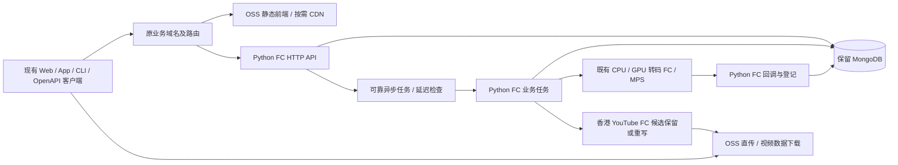

# Python Serverless 后端候选设计

状态：**提案，尚未实现**。本页不代表当前生产架构。对应 [2026-10-14 需求与可行性审计](../requirements/2026-10-14-serverless-backend/README.md)。

## 1. 架构与运行边界

图中只是候选边界，不代表必须分别创建这么多个函数。初期按依赖体积、延迟和任务性质分组，避免“一接口一函数”增加小时最低消费和冷启动数量。静态首页快速显示与首个视频列表、播放鉴权、首帧加载分别验收。

## 2. Python 与框架选择

- Python 是本轮候选语言；FastAPI 不是 FC 的组成部分。
- 优先比较内置 Python HTTP Handler（代码包）与 FastAPI + 轻量 ASGI Server 的 Web 函数（代码包/自定义运行时），不把 FastAPI 当成无需初始化的内置框架。
- 用同样鉴权、Mongo 查询和响应数据对比；FastAPI 默认错误码/参数校验需显式适配原接口。禁止在同步 async 路由内直接执行阻塞驱动造成串行等待。
- 先使用 PyMongo，不引入自动改变集合名、字段或类型的 ODM；每实例复用客户端，小连接池，设置连接/选择服务器/等待池超时并压测扩容时连接总量。
- 普通 API 不打包 yt-dlp、FFmpeg、av 等媒体依赖；现有 GPU/CPU 媒体容器不因 API 改造而被强制改成内置运行时。
- 最小实例数 0，无预热保活。FC 的 CPU 小时最低消费和延迟释放仍适用；“Python”不改变平台计费规则。

## 3. MongoDB 连接：保留产品不等于保留位置

| 路线 | 可行性与代价 | 本轮状态 |
|---|---|---|
| 保留腾讯云 Mongo，FC 公网连接 | TLS/认证、访问控制和跨云延迟需确认；固定出口可能引入 NAT/EIP 闲置费用 | 网络原型候选，不默认开公网、不默认允许任意来源 |
| Mongo 搬到阿里云同地域同 VPC | FC 配置 VPC 后私网访问；少一个跨云环节，但数据库实例/存储有常驻费用，仍需正式迁移数据 | 性能优先的候选建议，未获迁移/采购授权 |
| 云间私网互联 | 可避免公网暴露，但有链路与维护费用 | 不作为低用量默认方案 |

原腾讯云私网地址不能直接供阿里云 FC 使用。必须比较 DNS、TCP/TLS、Mongo 拓扑发现、首次认证、查询、多次串行数据库往返和端到端时间。托管 Mongo 与自建 Mongo 的价格、版本兼容及 replica set 能力另行核实；不能把换数据库位置附带为无成本操作。

## 4. 异步任务与不丢工作

现有业务实体和 task/attempt/deadline 仍是业务状态源，成功后才能改变业务状态。重复消息/回调通过数据库条件更新互斥；不能使用函数内存锁。

普通 API 返回前必须完成其所需的持久化、可靠任务受理或日志记录；不能用 FastAPI BackgroundTasks、Python 后台线程替代 Java 线程。Webhook 一次投递一个执行片段，退避等待交给调度；MPS 已提交 job 仅查询，不能重发。

**未解决门槛：Mongo 写入与任务投递不构成原子事务。** 单纯“写库后发队列”会在两步之间崩溃时丢工作；反过来投递后写库同样有间隙。Mongo outbox 只有在有可靠唤醒/消费来源时才完整，不能取消所有扫描后宣称不会丢任务。

原型需对比：先进入受持久化保障的编排，再执行业务步骤；或可靠 outbox 消费（需核实 replica set/change stream、断连恢复和常驻依赖）；或低频兜底扫描。最后一项会产生无用户请求调用，与严格零空扫有取舍。尚未选定产品/机制，必须在保留任务恢复及既有响应语义的前提下确认，不擅自增加新业务字段或减少故障恢复能力。

## 5. 分组、兼容和回退

- 一组轻量 HTTP API 和必要回调入口；任务、账单/OSS 批处理按资源和权限隔离，香港下载独立地域。
- API/任务的参数使用既有身份或受控对象引用，异步 payload 不塞大 manifest、视频字节或所有分片列表。
- 原域名路径映射、302、m3u8、用户凭证和播放签名必须连续兼容；签名密钥沿用原配置，避免切流使现有播放失效。
- 灰度期间每条写业务和每个后台工作只有一个所有者。只读影子对比也必须跳过观看计数、点击统计、审计写入等隐含副作用。
- 保持旧 Java 读取新写入数据和任务状态的能力。若需要不可逆模型变化，应先修改方案，不能把切回域名当成完整回滚。
- 数据库位置迁移独立于 API 切流；需要备份、增量同步/短维护窗口及单写者方案后另行执行，不在同次灰度双主写入。

## 6. 部署和成本

GitHub Actions 继续承担测试、取密、代码包发布、版本别名和回滚；设计不要求每个请求访问旧服务器/Infisical。新流水线、函数、域名、队列、Mongo/VPC 配置均尚未创建。

FC 最小实例数 0 不意味着总账单为零：视频 OSS 存储、Mongo、日志、消息基础设施及可能的 NAT/EIP 分项核算；每日计费、OSS 日志/清单任务仍执行。低用量预算必须先确定网络及恢复产品再计算，不能直接沿用前面 TableStore 估算。

## 7. 官方依据

- [FC Web 函数及代码包部署](https://help.aliyun.com/zh/functioncompute/creating-a-web-function)
- [FC HTTP 内置运行时协议](https://help.aliyun.com/zh/functioncompute/http-trigger-invoking-function)
- [FC 数据库集成/VPC](https://help.aliyun.com/zh/functioncompute/cloud-service-integration/)
- [FC 访问 MongoDB](https://www.alibabacloud.com/help/tc/functioncompute/fc/user-guide/access-the-mongodb-example)
- [PyMongo 客户端与连接池](https://www.mongodb.com/docs/languages/python/pymongo-driver/current/connect/mongoclient/)
- [FC 最低消费、释放与缩到零](https://help.aliyun.com/zh/functioncompute/product-change-description-on-optimizing-function-billing-mode)

读取日期：2026-10-14；支持能力不等于本项目已通过实测。
