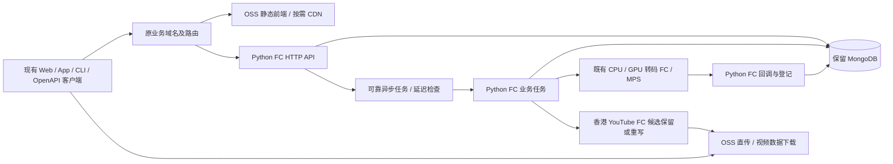

# Python Serverless 后端候选设计

状态：**实施中，分层与部分业务能力已实现；真实FC部署、完整业务迁移及生产切流尚未完成**。本页描述目标架构和实施边界，不代表当前生产架构。对应 [2026-10-14 需求与可行性审计](../requirements/2026-10-14-serverless-backend/README.md)。

## 1. 架构与运行边界



图中只是候选边界，不代表必须分别创建这么多个函数。初期按依赖体积、延迟和任务性质分组，避免“一接口一函数”增加小时最低消费和冷启动数量。静态首页快速显示与首个视频列表、播放鉴权、首帧加载分别验收。

## 2. Python 与框架选择

- 业务后端按轻量 Python 路线设计；FastAPI 不是 FC 的组成部分。框架由实施方依据真实冷启动和业务兼容结果选择，不再要求用户选择。
- 优先比较内置 Python HTTP Handler（代码包）与 FastAPI + 轻量 ASGI Server 的 Web 函数（代码包/自定义运行时），不把 FastAPI 当成无需初始化的内置框架。
- 用同样鉴权、Mongo 查询和响应数据对比；FastAPI 默认错误码/参数校验需显式适配原接口。禁止在同步 async 路由内直接执行阻塞驱动造成串行等待。
- 先使用 PyMongo，不引入自动改变集合名、字段或类型的 ODM；每实例复用客户端，小连接池，设置连接/选择服务器/等待池超时并压测扩容时连接总量。
- 普通 API 不打包 yt-dlp、FFmpeg、av 等媒体依赖；现有 GPU/CPU 媒体容器不因 API 改造而被强制改成内置运行时。
- 最小实例数 0，无预热保活。FC 的 CPU 小时最低消费和延迟释放仍适用；“Python”不改变平台计费规则。

## 3. MongoDB 连接：保留产品不等于保留位置

用户确认本轮继续使用现有 MongoDB，不做 TableStore 迁移；业务数据模型保持。下表是连接调查的技术备选，不表示用户批准迁库、采购或开放公网。先调查现有部署的安全连接和延迟，只有发现需要额外迁移/固定费用时才提交具体方案。数据库选型本身不再是待确认项。

| 路线 | 可行性与代价 | 本轮状态 |
|---|---|---|
| 保留腾讯云 Mongo，FC 公网连接 | TLS/认证、访问控制和跨云延迟需确认；固定出口可能引入 NAT/EIP 闲置费用 | 网络原型候选，不默认开公网、不默认允许任意来源 |
| Mongo 搬到阿里云同地域同 VPC | FC 配置 VPC 后私网访问；少一个跨云环节，但数据库实例/存储有常驻费用，仍需正式迁移数据 | 性能优先的候选建议，未获迁移/采购授权 |
| 云间私网互联 | 可避免公网暴露，但有链路与维护费用 | 不作为低用量默认方案 |

原腾讯云私网地址不能直接供阿里云 FC 使用。必须比较 DNS、TCP/TLS、Mongo 拓扑发现、首次认证、查询、多次串行数据库往返和端到端时间。托管 Mongo 与自建 Mongo 的价格、版本兼容及 replica set 能力另行核实；不能把换数据库位置附带为无成本操作。

## 4. 异步任务与不丢工作

现有业务实体和 task/attempt/deadline 仍是业务状态源，成功后才能改变业务状态。重复消息/回调通过数据库条件更新互斥；不能使用函数内存锁。

普通 API 返回前必须完成其所需的持久化、可靠任务受理或日志记录；不能用 FastAPI BackgroundTasks、Python 后台线程替代 Java 线程。Webhook 一次投递一个执行片段，退避等待交给调度；MPS 已提交 job 仅查询，不能重发。

**未解决门槛：Mongo 写入与任务投递不构成原子事务。** 单纯“写库后发队列”会在两步之间崩溃时丢工作；反过来投递后写库同样有间隙。Mongo outbox 只有在有可靠唤醒/消费来源时才完整，不能取消所有扫描后宣称不会丢任务。

原型需对比：先进入受持久化保障的编排，再执行业务步骤；或可靠 outbox 消费（需核实 replica set/change stream、断连恢复和常驻依赖）；或低频兜底扫描。最后一项会产生无用户请求调用，与严格零空扫有取舍。尚未选定产品/机制，必须在保留任务恢复及既有响应语义的前提下确认，不擅自增加新业务字段或减少故障恢复能力。

## 5. 分组、兼容和回退

- 一组轻量 HTTP API 和必要回调入口；任务、账单/OSS 批处理按资源和权限隔离，香港下载独立地域。
- API/任务的参数使用既有身份或受控对象引用，异步 payload 不塞大 manifest、视频字节或所有分片列表。
- 原域名路径映射、302、m3u8、用户凭证和播放签名必须连续兼容；签名密钥沿用原配置，避免切流使现有播放失效。
- 灰度期间每条写业务和每个后台工作只有一个所有者。只读影子对比也必须跳过观看计数、点击统计、审计写入等隐含副作用。
- 保持旧 Java 读取新写入数据和任务状态的能力。若需要不可逆模型变化，应先修改方案，不能把切回域名当成完整回滚。
- 数据库位置迁移独立于 API 切流；需要备份、增量同步/短维护窗口及单写者方案后另行执行，不在同次灰度双主写入。

## 6. 部署和成本

GitHub Actions 继续承担测试、取密、代码包发布、版本别名和回滚；设计不要求每个请求访问旧服务器/Infisical。新流水线、函数、域名、队列、Mongo/VPC 配置均尚未创建。

FC 最小实例数 0 不意味着总账单为零：视频 OSS 存储、Mongo、日志、消息基础设施及可能的 NAT/EIP 分项核算；每日计费、OSS 日志/清单任务仍执行。低用量预算必须先确定网络及恢复产品再计算，不能直接沿用前面 TableStore 估算。

## 7. 官方依据

- [FC Web 函数及代码包部署](https://help.aliyun.com/zh/functioncompute/creating-a-web-function)
- [FC HTTP 内置运行时协议](https://help.aliyun.com/zh/functioncompute/http-trigger-invoking-function)
- [FC 数据库集成/VPC](https://help.aliyun.com/zh/functioncompute/cloud-service-integration/)
- [FC 访问 MongoDB](https://www.alibabacloud.com/help/tc/functioncompute/fc/user-guide/access-the-mongodb-example)
- [PyMongo 客户端与连接池](https://www.mongodb.com/docs/languages/python/pymongo-driver/current/connect/mongoclient/)
- [FC 最低消费、释放与缩到零](https://help.aliyun.com/zh/functioncompute/product-change-description-on-optimizing-function-billing-mode)

读取日期：2026-10-14；支持能力不等于本项目已通过实测。

## 8. 可迁移性与代码依赖（用户已确认，S01 实施）

当前只部署阿里云、继续现有 Mongo，但公共代码不与特定平台绑定。S01 已对现有原型落实下列边界，不代表完整生产业务已迁移；不提前实现其他云或 PostgreSQL。

```text
serverless/src/video_serverless/
  business/prototype.py  # 普通 Python 原型用例
  ports/probe.py         # 用例实际需要的能力和普通结果类型
  application.py         # 通用 HTTP 路由、鉴权、错误映射
  http.py                # 通用 HTTP 值，不含 FC envelope
  adapters/
    fc.py                # FC event/response 编解码及 Handler
    asgi.py              # FastAPI/ASGI 外壳
    mongo.py             # PyMongo、查询及惰性连接池
  bootstrap.py           # 配置与具体实现装配
  fc_handler.py          # 保留原稳定 Handler 入口
  web.py                 # 保留原稳定 ASGI 入口
```

本轮只建立已有原型需要的文件；OSS/STS、任务及发布工具随对应阶段加入，不创建空抽象。业务用例只依赖真正需要的端口，不为每个方法机械套一层包装。

| 边界 | 必须保持 | 禁止/不承诺 |
|---|---|---|
| 运行外壳 | FC 和 FastAPI 调用同一用例，负责 HTTP 编码、鉴权上下文入口及错误映射 | business 不导入 FastAPI/Starlette/FC SDK，不接收 FC event、SDK context 或平台 response envelope |
| 数据库 | 端口表达业务查询、分页/排序、唯一性、原子认领和所需事务语义 | 不把 Mongo 查询字典、aggregation pipeline、ObjectId、游标、session 作为公共参数；不假定换 PG 改连接串即可 |
| 文件/凭证 | 端口表达对象读写、metadata、授权 URL/上传凭证所需行为 | bucket/endpoint、STS/OSS 客户端及异常在适配层；不要求历史媒体 URL 立即换掉而破坏兼容 |
| 异步任务 | 公共任务身份、载荷、重试/deadline 和状态含义保持，平台引用仅由适配层映射 | FC request ID、MNS 专有类型或工作流状态不成为业务唯一状态源 |
| 配置和秘密 | 装配层从受控环境取配置，公共用例接收依赖 | 不在业务里读 ALIYUN_*、临时凭据文件或自行下载并执行 OSS 源码 |

将来 PostgreSQL/Mongo 切换时，需要分别实现查询、唯一约束、TTL/过期、原子 CAS、金额、时区和事务边界，并跑同一套仓储契约和全业务对照；无法等价的能力应显式暴露约束，不做静默降级。本轮只实现 Mongo 适配器，不能宣称未来已经兼容 PG。

换云需替换运行入口、对象存储、上传授权、消息/任务及发布配置，重测客户端上传、播放签名和故障恢复；阿里云 SDK 的底层调用不能完全消失，但应集中在适配器，不散落在业务中。文件格式/数据库导出方案要覆盖数据类型及结构元数据，定期恢复证明另列后续阶段，不把“能导出”当“换云已验证”。

S01 已增加依赖边界检查和两个外壳的公共用例一致性测试，实际结果见验收记录；后续每个仓储实现使用能力契约测试，不能只通过改名或搬文件声称可迁移。

### S01 本轮实现边界（2026-10-14）

本轮只整理现有健康/空请求/单条只读诊断原型，不添加生产业务路由。实际按能力最小拆分：`business/prototype.py` 使用普通 Python 结果及 `ports/probe.py` 能力接口；`application.py` 负责通用 HTTP 路由/鉴权/错误映射；`adapters/fc.py`、`adapters/asgi.py` 负责运行协议；`adapters/mongo.py` 独占 PyMongo/BSON 查询；`bootstrap.py` 读取配置并装配。原 `fc_handler.handler` 和 `web:app` 入口保留为薄包装。

- Mongo URI、数据库名和诊断 token 由装配层读取，按进程构建并复用应用/连接池；配置变更通过实例替换生效，不在业务层读取环境变量。
- 连接仍惰性创建，健康/空请求不加载 PyMongo 或连接 Mongo；不额外启动保活/预热线程；驱动连接池在 FC 上的实际行为仍需 S04 验证。
- 实例 ID/调用序号只属于诊断 HTTP 层，使用锁保护；不是跨实例持久业务状态。共享工厂的首次并发初始化也必须有锁。
- 端口只返回 bool/float 等普通字段组成的只读探测结果；不能泄漏查询字典、游标或 Mongo 对象。时钟由装配注入，使两个入口可比较相同用例结果。
- 当前没有 OSS/任务用例，不创建空适配器或虚假数据库通用接口；随后续实际业务按同一边界接入。
- 保持原型 HTTP 状态、正文、鉴权顺序、二进制/Base64、m3u8/302 行为；路由及真实业务契约的完整迁移不属于 S01。
- 验收包含公共层依赖边界、替换探测端口、两种外壳的成功/失败对照、并发初始化与连接复用、现有回归及隔离 Mongo CI。本地未连真实 Mongo 时明确 skipped。

## 9. Git 唯一源码与单向发布（用户已确认，S02/S03 实施）

发布方向固定为：**Git 已知提交 → GitHub Actions 校验/构建 → OSS 构建产物 → FC 发布版本 → 环境别名/入口**。

- 所有自研运行代码、外壳、任务脚本、部署/构建工具和非秘密配置声明均在 Git。OSS 可以保存 ZIP、生成的 manifest、前端产物和业务媒体，不能保存 Git 没有的正式自研源码或成为在线编辑源头。
- 从干净提交和锁文件构建；构建白名单拒绝未跟踪脚本、工作区临时文件和秘密进入包。第三方依赖由锁文件/哈希声明，构建生成文件不属于需要手工提交的第二份源码。
- 推荐产物键包含组件、完整 Git SHA、目标平台/入口类型和内容摘要，例如 `releases/<component>/<git-sha>/<platform>/<flavor>/<sha256>.zip`；不覆盖同键、不仅用 latest。manifest 记录仓库、SHA、锁文件摘要、包摘要和工作流 run，不含密钥。
- dev/prod/原型函数与配置隔离；相同构建产物可晋级，环境变化不复制业务源码。配置非秘密部分归 Git，秘密来自现有取密系统；回滚/手动触发也只能选择已验证的 Git 对应版本，不接收任意外部包 URL。
- 部署前后校验对象摘要、函数版本和来源记录；如发现控制台/OSS 漂移，拒绝把未知代码当正式发布，先记录差异，再经 Git/CI 恢复。禁止从线上反向同步源码覆盖 Git。
- FC 自定义运行时、触发器/别名、网络及权限由版本化脚本管理；具体 IAM、OSS 前缀、函数名称和最低权限在 S03 调查，不本轮直接改线上配置。

这条规则同样适用于其余组件：现有媒体函数镜像已来自 Git/CI，继续保留；前端/YouTube/MD5 的现役来源须按阶段盘点，缺失的旧源码需先恢复到 Git 并核对，不能假称本轮原型已经让全部云上源码完成追溯。未经授权不修改或删除旧云资源。

### S02 构建来源方案（2026-10-14，已实现，Linux 专项验收通过）

以下为 S02 已实现设计；本地及 Linux 专项结果见验收和进度文档。PR 合并仍以最新 head 全部必要 CI 为准，FC 云端验收留在 S03/S04。

新增 `serverless/release/` 中的纯 Python 构建/验证工具。正式构建只允许 Linux x86_64、Python 3.12.12、uv 0.12.2；从干净 HEAD 的 Git 对象读取白名单输入，拒绝脏/未跟踪文件、符号链接和工作树内输出。构建中间文件及输出均位于系统任务临时目录，不能打包工作树、环境文件、测试、开发依赖或 `.git`。

- handler/web 两种包分别导出锁定运行依赖；只接受带哈希的二进制 wheel，目标 `x86_64-manylinux_2_28`，不在 Windows 安装依赖再上传。两个包使用同一公共业务源码，各自保留原入口，不复制业务分支。
- 白名单源码取 Git blob，依赖使用 `uv export --locked --no-dev --no-emit-project` 后以哈希安装。ZIP 固定顺序、时间与权限；剔除 pycache、命令包装和安装器生成的非运行元数据，保留分发包元数据及许可证。
- sidecar manifest 记录完整 Git SHA、仓库、输入/锁文件/requirements 摘要、依赖版本、目标和工具版本、CI run、ZIP 摘要及逐文件摘要。ZIP 不包含自身 manifest，避免摘要循环；不写密钥、连接串或绝对构建路径。
- requirements 同时放入 ZIP 的 `release/requirements.txt`，以外部可信 ZIP 摘要绑定，并与 sidecar 逐字节比较；manifest 的依赖名称/版本与包内 `.dist-info/METADATA` 对照，拒绝缺失、重复或不一致的依赖记录。坏 ZIP/CRC/非法 JSON 明确拒绝。
- 验证器必须收到可信来源的预期 commit 和 ZIP SHA256，并回读 Git 输入及白名单源码；拒绝篡改、缺失/额外文件、重复/危险 ZIP 路径和符号链接。manifest 本身不是签名；S03 只能从受控 CI 取得预期摘要，不能仅相信随包上传的 manifest。
- CI 构建两次比较 ZIP 字节摘要，并从解包产物验证 native 和 ASGI 入口与原生依赖导入。Linux runner 验证不等于 FC/Debian 11 云端验证；Python 3.12 的地域/公测状态及实际 FC 配置由 S03/S04 核对。
- S02 不上传 OSS、不创建函数，也不实现环境发布；临时产物验证后清理。S03 将复用工具接发布和受控产物保留。

## 10. 官方取舍与接续

每个小阶段查阅并记录相关 [官方依据](../requirements/2026-10-14-serverless-backend/overview/official-guidance.md)，明确官方事实/项目决定/待实测三者的区别。按 [小阶段计划](../requirements/2026-10-14-serverless-backend/plan.md) 多 PR 交付，重要状态及时写入 [接续记录](../requirements/2026-10-14-serverless-backend/progress.md)，不能依赖一次对话完成全部迁移。

### S03 隔离发布方案（2026-10-14，实施中）

先交付 Handler 路线，不把 Web 的自定义 Python 运行时兼容猜测作为已验证结论。固定 `cn-beijing`、函数 `video-2022-dev-serverless-api`、`candidate`/`dev` 别名；禁止参数选择生产函数、业务域名或其他地域。配置采用 0.25 vCPU / 512 MB、单实例并发 1、函数并发上限 2、无预留实例；API 原型无 Mongo 配置、无 VPC/公网出站依赖，只验健康与空请求。

- 新增独立 `deploy-serverless.yml`，只允许手动 dispatch 受控 master 提交。先验证对应 Git 来源/必要 CI，再从干净 Git 对象构建 Linux Handler 包；取密在测试构建通过后进行。Infisical Actions OIDC 复用现有身份，FC 部署身份和 OSS 数据身份分开注入，不把运行时变成有 OSS/部署权限的业务函数。
- 使用既有 `oss-data-bucket` 的 `video-2022-dev/serverless/releases/` 独立前缀；ZIP 键包含完整 commit/ZIP SHA，生成元数据键也含内容 SHA。禁止覆写，存在时回读同摘要才复用。上传后回读 ZIP/sidecar 并验证，才进入 FC。
- 当前 FC 部署 RAM 身份没有 OSS 权限。S03 使用从 OSS 回读并按可信 SHA 验证的同一 ZIP 字节作为 FC `code.zipFile`，避免为代码获取扩大该身份的权限；这仍是 Git→CI→OSS 产物→FC 的单向来源链，不能绕过 OSS 回读或从另一份源码重建晋级包。普通运行时不获得任何发布身份。
- 发布函数版本前/后通过 GetFunctionCode 下载并核对 ZIP/源码摘要；版本描述关联完整 commit、ZIP SHA。candidate 验证成功才将同一 versionId 晋级 dev，不能再打包。dev 失败恢复原 alias/version 并验证；首次发布无前版则记录没有可恢复旧版本，不假造回退成功。
- HTTP 触发器限定 GET/POST、RAM function 鉴权、dev 别名；诊断入口仍须随机诊断 token。token 仅驻留受控函数配置/内存，不进入 receipt/产物/日志。SDK InvokeFunction 用同一受控身份做有限健康/空请求冒烟，不保活、不调用生产 Mongo。
- 产物与 receipt 使用不可变内容键，保留当前及前版；S03 不自动删除未知/其他组件对象或历史版本。实际云端发布、同包晋级及回退实测分别记录，没有跑通不标阶段完成。
- 构建/部署/取密工具在 Git，临时依赖环境和下载包用系统任务临时目录并清理；发布工具的 SDK 依赖单独锁定，不能进入 API ZIP。FC Python 3.12 公测和云端 ABI 的实际支持仍需发布后验，失败不改为未知版本绕过。

### S03.b 不可变 OSS 上传前提与候选最小权限

上传前读取原始 versioning XML，仅接受无Status的从未启用状态，拒绝Enabled/Suspended/未知XML/权限失败；x-oss-forbid-overwrite在版本控制bucket失效，不能单凭请求头宣称不覆写。锁定SDK的公开解析器漏namespace，适配层复用认证请求并严格有界解析，真实云端仍未验。候选RAMrole/trust和边界见 [隔离权限方案](../requirements/2026-10-14-serverless-backend/deployment/isolated-oss-policy.md)：仅GetBucketVersioning及dev前缀GetObject/PutObject，未创建角色、未改现有用户权限、未实现STS装配，部署仍受身份阻塞。

### S06.a 用户读取能力（未装配）

UserReads端口仅按token/ID读取不可变标准值快照，Users纯用例保持旧token字符串和公开返回凭据清空语义，user_responses编码现有Result/字段/null/UTC日期。四个真实隔离Java HTTP固定夹具已离线对照。当前没有Mongo用户适配器、请求上下文/日志装配或新业务路由，健康/诊断原型不变；下一阶段需旧集合/ID转换/构造默认及完整HTTP验证，不能把这一能力库称为生产迁移。

### S06.b2 用户Mongo读取（未装配）

独立MongoUserReads复用装配传入的惰性database provider，每次单文档有界读取，显式UTC解码。保留Java基线中的缺失/null、ObjectId查询优先级和已验证转换，四份Java HTTP黄金响应已经真实隔离Mongo对照。未验证BSON类型固定错误不含值，仍须补证据后才能装配，不能把未支持类型当新增生产校验。当前不接业务路由/日志/登录写入，也无FC网络验证；详见[适配器边界](../requirements/2026-10-14-serverless-backend/user/user-mongo-reads.md)。

### S06.c2 资料与频道纯读取（未装配）

Profiles共享UserReads，AvatarFiles/AvatarUrls仅传字符串key/ID/有效秒数，返回普通快照；本人资料清空返回token/动态头像，频道保留8字段和null计数补0。真实Java黄金HTTP9项和5份新夹具对照通过；真实Mongo仅验证用户读取组合，头像端口仍替代。具体适配器、完整HTTP上下文/日志/错误与路由仍未装配，详见[用例边界](../requirements/2026-10-14-serverless-backend/user/profile-channel-reads.md)。

### S06.c3 头像File读取（未装配）

MongoAvatarFiles复用惰性database provider，对旧file集合有界只读，保持ID转换、key/null和原读取不按owner/type/deleted过滤的行为。真实Java5项/Python201项通过，profile/channel组合已读取真实user+file集合；仅签名替代。其他BSON字段转换、真实OSS签名及完整HTTP/日志仍待，详见[适配边界](../requirements/2026-10-14-serverless-backend/user/avatar-mongo-reads.md)。

### S06.d1 HTTP身份/日志基线

真实Java HTTP6项确认身份首值与鉴权顺序、401前置拒绝无requestLog、处理后状态与同步落库/清理。旧日志保存原始headers/query含凭据，已记录且仅用隔离合成值验证，不能称已脱敏。Python完整请求作用域/多值元数据/日志与错误尚未装配，不提前暴露业务路由；详见[上下文契约](../requirements/2026-10-14-serverless-backend/http/request-context-contract.md)。

### S06.d2 请求作用域普通值（未装配）

RequestMetadata保留有序重复headers/参数与原query/peer信息，IdentityResolver按旧首值/空值语义返回局部不可变身份，无全局/ThreadLocal缓存。真实Java7项/Python217项通过；空header无参数仍可能匹配旧空token已记录，未改生产规则。现有FC/ASGI外壳未接多值转换/日志/鉴权门槛，不能据此启用业务路由，详见[请求身份能力](../requirements/2026-10-14-serverless-backend/http/request-identity.md)。

### S06.d3 ASGI多值采集（未装配）

独立转换器从原始scope保留重复headers、原URI/query和peer，通过锁定Starlette multi_items得到有序参数；未支持表单合并/缺原始字段时明确失败。真实TestClient及完整Python225项通过，但现有入口未调用、FC/代理/完整HTTP尚未验，详见[采集边界](../requirements/2026-10-14-serverless-backend/http/asgi-request-metadata.md)。

### S06.d4 日志故障语义

真实Spring/隔离Mongo与指定方法异常注入3项确认：日志afterCompletion save失败不会撤销成功响应或业务写，但旧日志ThreadLocal清理被跳过；身份查询提前失败则未进入日志。未改运行代码；Python请求生命周期需保留业务提交/响应边界并可靠清理局部状态，不能假设日志失败应重试业务。详见[故障基线](../requirements/2026-10-14-serverless-backend/http/request-journal-failure.md)。

### S06.d5 普通请求生命周期（未装配）

RequestCycle保留首次身份、受保护第二次查询、401形状、处理后同步journal与精确路径排除；日志save失败保留响应/业务写并返回内部failed诊断，不重放业务。局部值不复制旧ThreadLocal泄漏；具体journal/域异常/外壳路由尚未装配。Java黄金HTTP11项、完整Python235项通过，详见[生命周期边界](../requirements/2026-10-14-serverless-backend/http/request-cycle.md)。

### S06.e1 资料更新（未装配）

ProfileUpdates保留旧UTF-16长度与双字段替换，MongoProfileWrites仅更新nickname/bio/updateTime，不upsert/不回退String ID、不接生产路由。JavaHTTP14+Mongo6项、Python247项通过，写入仅随机隔离库；JSON绑定/完整鉴权日志与真实网络仍待，详见[更新边界](../requirements/2026-10-14-serverless-backend/user/profile-update.md)。

### S06.e2 JSON绑定兼容门槛

旧资料更新HTTP已实测整数/布尔转String、未知字段忽略，容器或非法正文HTTP200/code1且不写资料。Python字符串端口不等于JSON绑定兼容；详见[基线](../requirements/2026-10-14-serverless-backend/user/profile-json-binding.md)，尚不装配生产更新路由。

### S06.d6 日志存储边界

未装配MongoRequestJournal复用provider，同步写requestLog并保持旧BSON形状。生命周期处理日志失败，不重放业务。仅隔离库验证；特殊header键、实际网络不确定写入与日志安全策略仍为验收门槛，详见[记录](../requirements/2026-10-14-serverless-backend/http/mongo-request-journal.md)。

S06.d7实测收窄日志门槛：含点header使旧日志失败但不改变业务响应/写入；$前缀名可落库。Python按该边界返回内部failed，不复制旧ThreadLocal残留。特殊键仍未穷举，未接生产入口。

### S06.f1 隔离HTTP组合证据

测试专用ASGI链路已组合元数据、身份、真实Mongo资料/头像元数据和同步日志，5份旧Java响应/3份401与日志失败恢复对照通过；签名仍替代。该应用只存在测试中，不是正式路由表或FC入口，详见[组合边界](../requirements/2026-10-14-serverless-backend/user/profile-http-composition.md)。

### S06.e3 JSON值绑定（未装配）

普通decode_profile保留小数/指数原始词法、每次重复字段的类型检查与后值语义，并拒绝旧HTTP实测的尾随内容。只针对已验UTF-8；编码/极端输入和完整更新HTTP尚未验，详见[解码边界](../requirements/2026-10-14-serverless-backend/user/profile-json-decoder.md)。

### S06.f2 更新HTTP隔离组合

测试专用ASGI POST链路组合身份/JSON/业务校验/真实Mongo更新与日志，旧成功/长度/绑定/401响应及实际更新次数通过；仅已验UTF-8、进程内TestClient，不修改现有入口，详见[组合证据](../requirements/2026-10-14-serverless-backend/user/profile-update-http.md)。

2026-10-15夜间交付与尚未通过的阶段，汇总于[验收与恢复清单](../requirements/2026-10-14-serverless-backend/overview/night-review.md)。运行入口/真实云端验收按该清单与progress保留边界，不能把未装配库称为生产迁移完成。

## 文件访问计费迁移门槛

先以完整Spring隔离契约验证302和异步日志实际结果，见[file/access基线](../requirements/2026-10-14-serverless-backend/playback/file-access-contract.md)。文件访问不可隐式启用第二计费所有者，可靠任务与两次写入恢复需独立验收。

## 统一隔离播放装配（2026-10-15）

BackendApplication 显式工厂可成对提供播放签名密钥与内部地址，复用用户 RequestCycle 装配观看信息和 HLS。默认入口不变；详见[路由装配验收](../requirements/2026-10-14-serverless-backend/playback/backend-watch-routing.md)。

BackendApplication 显式工厂可成对提供播放签名密钥与内部地址，复用用户 RequestCycle 装配观看信息和 HLS。默认入口不变；详见[路由装配验收](../requirements/2026-10-14-serverless-backend/playback/backend-watch-routing.md)。

## S12.a 恢复前置故障证据

先使用真实随机Mongo与手工装配验证FcTask认领前/派发后的持久化边界，不启Spring调度、不新增生产机制。对象重建不等于真实进程崩溃；严格零空扫和可靠唤醒仍未解决，见[故障基线](../requirements/2026-10-14-serverless-backend/tasks/task-submission-persistence.md)。

## 文件重定向能力边界（2026-10-15）

纯用例验证短时HMAC后只读tsFile并请求三小时预签名，具体Mongo读取与普通端口分离。没有访问计费写入或HTTP入口装配；不能以此替代S12可靠计费，见[file-redirect](../requirements/2026-10-14-serverless-backend/playback/file-redirect.md)。

### S09心跳/进度基线（2026-10-16）

[真实HTTP契约](../requirements/2026-10-14-serverless-backend/playback/heartbeat-progress.md)固定小写playing与先保存心跳后更新进度；匿名正文viewer保留等旧行为不在迁移中擅改。尚未装配Python写入或播放会话/历史。

S09.b增加普通`ProgressHeartbeat`/`ProgressRecord`/`ProgressStore`与`ProgressUpdates`。Mongo适配复用惰性provider并有界findOne，save以原ID整文档替换/upsert（旧MongoTemplate.save语义），省略null且不写_class。保持旧读改写竞争语义；没有将它擅改成原子最大进度或单调时长规则。暂未接入任何应用入口。

S09.c增加不可变完整Heartbeat和同步存储端口；普通Heartbeats用例局部覆盖身份/创建时间，心跳存储成功后才调用进度能力，不回滚/重试先前写入。Mongo将音量转Decimal128、进度转Int64并保持指定ID替换语义。该能力仍未装配生产HTTP。

S09.d：[播放会话](../requirements/2026-10-14-serverless-backend/playback/playback-sessions.md)采用普通不可变snapshot/command与同步存储端口，保持旧start/心跳/退出读改写、Java int32回绕及Long/Integer/Date映射；未知BSON转换明确拒绝，不推定完整兼容。尚未装配HTTP/生产入口，未改既有Java运行规则。

S09.e：[观看历史](../requirements/2026-10-14-serverless-backend/playback/watch-history.md)采用普通HistoryStore/HistoryCoverUrls，按旧日志分页保留重复/失效视频，单次deleteMany不重试；签名逐行两小时。旧匿名null viewer语义仅隔离验收，不擅自改变登录规则。未安装到应用入口，watchLog创建和计数另验。

S09.f：显式HistoryProgressApplication按旧query/身份规则返回进度/历史及清理响应，复用RequestCycle与同步Mongo日志。旧Java4份全文夹具覆盖ISO UTC日期和null字段，ASGI隔离测试通过；未接入既有Backend/ASGI/FC入口。

S09.g：[观看日志基线](../requirements/2026-10-14-serverless-backend/playback/watch-log.md)固定先存在检查、按请求status去重/计数、按实际status保存，以及两次IP调用的部分失败顺序。旧增数使用BSON Long；迁移不得改成隐式业务重试或原子事务。Python能力待下一阶段。

S09.h：WatchLogs普通用例按旧顺序组合WatchLogStore/IpLocations，计数和事件写入不重试/不事务回滚；Mongo显式Int64增数并递归转换IP Decimal/null，事件使用实际视频ID/status。外部IP/缓存和HTTP仍独立，不导入业务层或装配生产入口。
